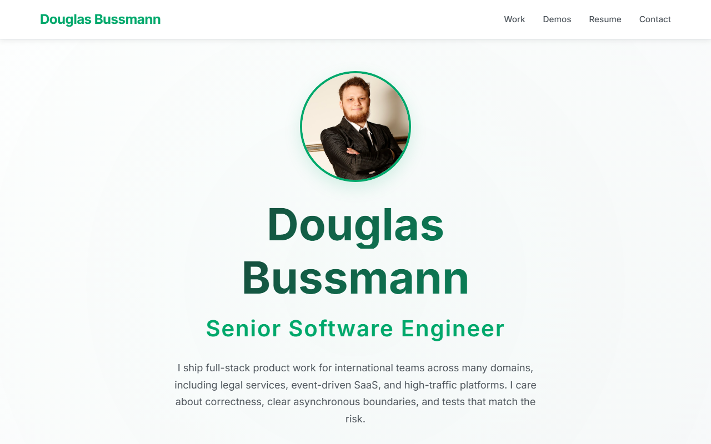

# Douglas Bussmann: Portfolio

A static portfolio for hiring conversations: selected work, three browser demos, and a full resume. Light theme, no build step.



## Features

- **Selected work**: three case studies (legal operations, event-driven SaaS, esports product)
- **Interactive demos**: event pipeline, testing lab, and an operations dashboard, all in the browser with fictional data
- **Resume**: experience, skills, education, and courses on their own page
- **Responsive**: desktop, tablet, and mobile
- **No dependencies**: HTML, CSS, and JavaScript only

## Project structure

```
index.html                          Home
resume.html                         Full resume
work/
  legal-operations.html             Torticity / BairesDev
  event-driven-platform.html        VOLL / Framework Digital
  esports-product.html              Gamers Club
demos/
  event-pipeline.html
  testing-lab.html
  ops-dashboard.html
styles/main.css
scripts/main.js                     Nav, scroll, fade-in
scripts/demos/                      Demo behavior
```

## Case study rule

Case studies use only what is on `resume.html`: role, company, dates, stack, and the results listed there. They do not include claimant data, internal system names, or numbers that are not on the resume. When the resume changes, update the case studies to match.

The demos are illustrations. They are not the products from those jobs.

## Getting started

Open `index.html` in a browser. No install step.

For the demos, a local static server is enough if the browser blocks anything; the pages do not fetch partials, so opening the files directly also works.

## Deployment

The site is static. GitHub Pages, Netlify, Vercel, or any file host will do. `CNAME` points at `douglasbussmann.com`.

## Customization

Colors live in the CSS variables at the top of `styles/main.css`. Copy edits belong in the HTML pages.

## Later ideas

- Blog
- Contact form
- Resume PDF download
- Dark mode
- Stronger SEO (Open Graph, structured data)
- PWA

## Browser support

Current Chrome, Firefox, Safari, and Edge.

## Author

**Douglas Bussmann**

- Email: douglasfelipebs@hotmail.com
- LinkedIn: [douglasfelipebs](https://www.linkedin.com/in/douglasfelipebs)
- Location: Curitiba, PR, Brazil
